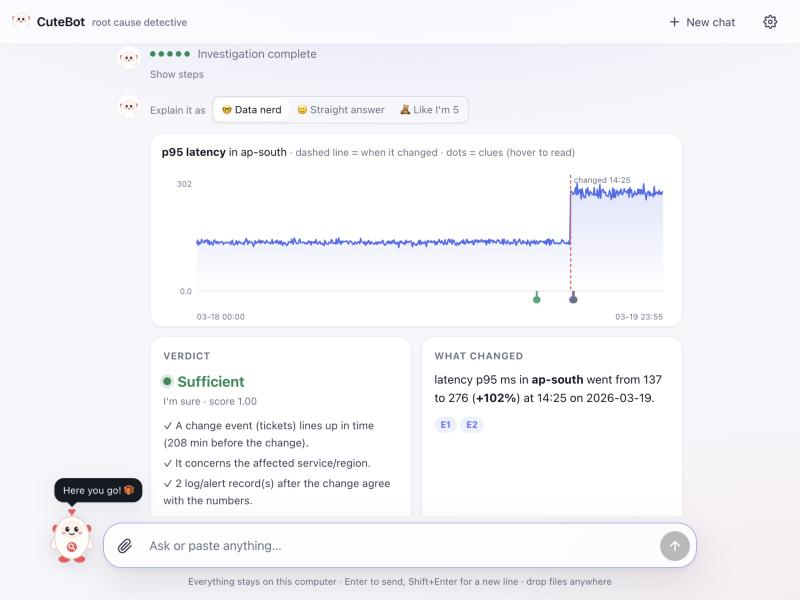

# RCA Investigator

**An evidence-first AI investigator for root cause analysis.**

Most AI assistants tell you *what* went wrong. RCA Investigator works like an investigator: it finds **what changed**, works out **why it happened**, shows **the evidence** behind every finding, says honestly whether that evidence is **enough to be sure**, and recommends **how to prevent it** from happening again.



**Two ways to use it**

- **Chat and upload**: open the web page, drop in files (CSV, Excel, PDF, Word, logs) or paste notes, and ask what went wrong. Made for anyone, technical or not.
- **Install and connect**: point it at your own database or folder of exports (read-only). CuteBot, the investigator, finds the right tables and time window by itself.

> Status: **v1.0**. See the [roadmap](docs/ROADMAP.md) and [how to contribute](CONTRIBUTING.md).

## What it does

Given numerical data (metrics over time) and text records (logs, tickets, deploy and config change notes), it:

1. **Detects what changed**: when the metric shifted, by how much, and in which segment (service, region, ...).
2. **Investigates why**: links the change to events in the text records and ranks the contributing factors.
3. **Cites evidence**: every claim points to a numbered piece of evidence (`E1`, `E2`, ...). Claims without evidence are rejected.
4. **Judges sufficiency**: returns a verdict of `sufficient`, `partial` or `insufficient`, with reasons and the data that would settle open questions.
5. **Recommends actions**: corrective and preventive actions linked to each contributing factor.
6. **Explains for every reader**: a data-nerd version, a straight answer, or an explain-like-I'm-5 story, with a chart and a downloadable report.

## Design principles

- **Statistics do the maths, the language model does the reasoning.** Numbers are analysed with proper statistical methods, never guessed.
- **No evidence, no claim.** The report format enforces that every cited evidence ID exists.
- **"I don't know yet" is a valid answer.** Insufficient evidence is reported, not hidden.
- **Free and local.** Runs on a laptop with an open model through [Ollama](https://ollama.com). No API keys, no costs, and your data never leaves your machine.

## How it works

```
 uploads, pasted text,      ┌─► Numerical engine ──┐
 or a connected database ──►│   (change points,     │
 (read-only)                 │    segment drill-down)├─► Evidence pack ─► LLM investigator ─► Sufficiency check ─► RCA report
        Ingest: find time,   └─► Text engine ───────┘   (numbered IDs)     + guardrails        (rules, not the LLM)   + chart, 3 styles
        numbers and records       (search, timeline)
```

The report format is defined in [`src/rca_investigator/schema.py`](src/rca_investigator/schema.py) and exported as a JSON Schema in [`schemas/rca_report.schema.json`](schemas/rca_report.schema.json). An example report is in [`examples/example_report.json`](examples/example_report.json).

## Quick start

Requirements: Python 3.10+ and [Ollama](https://ollama.com) (free).

```bash
git clone https://github.com/deekshaa4/rca-investigator.git
cd rca-investigator
python3 -m venv .venv && source .venv/bin/activate
pip install -e ".[dev]"

ollama pull qwen2.5:3b     # small open model, about 2 GB
rca check                  # confirms the model is reachable
rca simulate --n 20        # generates 20 incidents with known causes in data/generated/
rca simulate --n 50 --hard --out data/hard   # harder incidents with red herrings
rca analyze data/generated # finds what changed in each incident and scores it
rca search data/generated  # finds the records that explain each change and scores it
rca investigate data/generated/INC-001 --save   # full investigation report with the local model
rca batch data/generated   # investigates and scores every incident (about 30 s each)
rca evaluate data/generated   # re-scores saved reports, by scenario and by twist (no model needed)
pytest                     # runs the tests
```

## Web page: chat with CuteBot

```bash
pip install -e ".[web]"
rca serve                      # then open http://127.0.0.1:8000
```

A chat page where anyone can investigate **their own data**:

- **➕ Upload files** (or drag them in): CSV, Excel (.xlsx), PDF, Word (.docx), JSON, text or log files.
- **Type or paste** into the message box: a question, log lines, notes like `2026-05-01 14:40 Deployed api v3.1`, or a small table.
- **Ask** what went wrong. **CuteBot**, the investigator, leaves its corner and roams the page while it works, showing each stage: collecting the evidence, polishing the evidence, understanding the root cause, weighing it up, and coming back with the answer. The report then appears as cards (verdict with reasons, what changed, why it happened, ruled out, what to do, fact-check, all clues).
- **Follow-up questions** ("could it be traffic instead?") are answered from the report's evidence only. Share more data and it investigates again.
- **Try a sample** loads a practice incident; example CSV files show the expected format.

Everything runs on your own computer: uploads are kept in memory for the session only, and the model runs locally.

### Documents and any topic

Not every incident comes with numbers. Upload an incident write-up, emails or meeting notes (PDF, Word, text), or paste the story into the chat, and CuteBot investigates the text itself, on any topic (software, deliveries, operations, ...):

1. **Every part is read.** The document is split into pieces (pages, then sections) and every piece is scanned for sentences describing causes, symptoms, events and actions.
2. **The most relevant pieces are read closely** by the language model, which writes down each fact with an **exact quote**.
3. **Quote check:** a fact is kept only if its quote really appears in the document, so the model cannot invent evidence.
4. The model tells the story from the numbered facts; **rules** judge whether the documents are enough: is a cause actually stated, is it backed by more than one passage, are other causes suggested, is there a timeline?
5. **Follow-up questions** ("was it staff shortages?") are answered from the most relevant passages, with page references.

**Charts inside PDFs (local first, cloud optional).** CuteBot finds the pages that contain a chart and always reads the chart's caption and labels, instantly and on your computer. To have it *look at the picture* too (the trend, a sudden jump, when it happened), pick an option in the 📊 menu:

| Option | How | Speed | Privacy |
|---|---|---|---|
| Chart labels only (default) | captions and labels from the page text | instant | stays on this computer |
| Look on this computer | a local vision model in Ollama, e.g. `ollama pull qwen2.5vl:3b` | slower on a laptop (tens of seconds per chart) | stays on this computer |
| Look in the cloud | any OpenAI-compatible vision service: your own GPU server or a hosted provider (`RCA_CLOUD_VISION_URL`, `RCA_CLOUD_VISION_MODEL`, `RCA_CLOUD_VISION_KEY`) | a few seconds per chart | **only the chart pictures** leave the computer, after the user confirms |

Only charts are looked at (at most 4 per investigation), and what the model saw is shown as its own clue, marked *read from the picture* so it is never mistaken for a word-for-word quote.

**It understands what you're asking first.** Before doing anything, CuteBot works out whether the message is small talk, a request for a **summary**, a **question** about something shared, or a request to **investigate a problem**:

- Mention a file you haven't shared yet ("can you look at my account statement?") and it asks for it, instead of guessing.
- Ask for a summary and you get a summary (with any numbers the model wrote that aren't in the document flagged for checking).
- Ask "what went wrong?" about a document that doesn't describe any problem (a bank statement, meeting notes, an invoice) and it says so, summarises it and asks what looks wrong, instead of inventing an incident.
- Connected data is only used when the question is about it.

With no data at all, CuteBot can still answer general questions, clearly labelled *from general knowledge, not from your data*.

### Friendly chat and a memory you control

- **Human small talk.** "Hi!", "I'll send it in a minute", "sorry, I forgot", "can I share some docs?" get a friendly reply instantly, without the model. The replies live in a plain file, [`replies.md`](src/rca_investigator/replies.md) (about 170 replies for 15 situations), so they're easy to read and extend, and CuteBot avoids repeating itself.
- **Case notes (off by default).** Switch on **🧠 Remember** and, after each investigation, CuteBot writes a tiny Markdown note on this computer: what happened, the cause, the fix, how sure it was. Next time it recognises a similar case ("this reminds me of…"), and when you correct it ("no, it was actually the database") the correction is added to the note and shown next time. No model training, nothing leaves the computer, and **Forget** (or `rca memory --forget`) deletes everything. `rca memory` lists the notes; `rca serve --no-memory` turns the feature off.

### Control centre (for whoever runs CuteBot)

`rca serve` also opens a control centre at `/admin`, available **only from the same computer**:

- **Inspector:** every message with what CuteBot decided and *why*, the exact file and line that made the decision (one click opens it in VS Code), every call to the language model (instructions, prompt, reply, time taken) and everything sent back. Kept in memory only.
- **Replies:** edit the reply situations and trigger words in `replies.md`, and try a message to see which reply it gets.
- **Settings and look:** the model, how sure "sure" must be, how much of a document the model reads closely, the default chart mode, and the chat page's font, text size, accent colour, roundness, message-box height and spacing. Saved to `~/.rca-investigator/settings.json` and applied immediately.
- **Health:** run all the tests, or the accuracy check on practice incidents.
- **Where to change what:** common changes mapped to their file and line.

Turn it off with `rca serve --no-admin`.

### Connect it to your own data

Install it next to your data and point it at a database or a folder. CuteBot explores the data itself: it samples every table, works out which ones hold numbers over time and which hold records (deploys, config changes, alerts, tickets, logs), and when you ask a question it picks the right table and loads only the time window the question is about.

```bash
pip install -e ".[web]"
rca sources --source shop.db             # what CuteBot finds in your data
rca serve --source shop.db --source ./exports
```

- **Sources:** SQLite files out of the box; Postgres, MySQL and others through SQLAlchemy (`pip install sqlalchemy` plus the driver, then `--source postgresql://user@host/db`); folders of CSV, Excel, JSON, PDF, Word, text or log files.
- **Read-only and local:** SQLite is opened read-only, only fixed `SELECT` queries written in the code are run (never SQL written by the user or the model), and nothing leaves the machine.
- **Try it:** `rca demo-db` writes a small company-style database (`service_metrics_5min`, `deploys`, `alerts`, `support_tickets`, `app_logs`), then `rca serve --source demo.db` and ask *"Our website had problems on 17 March, what went wrong?"*

### Answers for every reader

CuteBot guesses from the wording whether the person asking is technical, and every report can be switched between three explanations:

| Style | Who it's for | What it shows |
|---|---|---|
| 🤓 Data nerd | engineers, analysts | exact numbers, change point, evidence IDs, failed checks, fact-check counts, all cards |
| 🙂 Straight answer | managers, most readers | verdict, main cause, what to do first; details folded away |
| 🧸 Like I'm 5 | anyone new to the topic | a short story with everyday comparisons; details folded away |

Each report also has a **chart** of the measure that changed (with the change point and the clues pinned to the timeline), a **Download report** button (Markdown) and **Print or save as PDF**.

### What data it understands

| Kind | Format | Needs | Optional |
|---|---|---|---|
| Table of numbers | CSV, TSV, JSON, Excel (.xlsx), or a table of dated rows inside a PDF or Word file | a time column (`timestamp`, `time`, `date`, ...) and at least one numeric measure | `service`/`app` and `region`/`zone` columns, a request count |
| Records | CSV/JSON/Excel with a text column, or text, log, PDF or Word files with dated lines | a date and time on each record | `source`/`type`, service and region columns |

Column names are matched loosely, and each record is sorted into deploys, config changes, alerts, tickets or logs from its wording. Pictures of charts and scanned PDFs can't be read yet: upload the numbers behind the chart instead. Unreadable files get a message saying what to upload instead.

## Test incidents

To measure whether the investigator finds the *right* cause, it needs incidents where the truth is known. `rca simulate` generates software-service incidents (4 services x 3 regions, 48 hours of 5-minute metrics, plus deploy notes, config changes, alerts, tickets and logs) with one of five injected scenarios:

| Scenario | What happens | Expected verdict |
|---|---|---|
| `bad_deploy` | A release breaks one service in one region | sufficient |
| `config_change` | A config change slows one service everywhere | sufficient |
| `traffic_spike` | A campaign triples traffic in one region | sufficient |
| `dependency_outage` | An upstream dependency fails | sufficient |
| `no_clear_cause` | Errors rise with no record explaining why | **insufficient** |

With `--hard`, each scenario also gets one of these twists, and the metrics are noisier:

| Twist | What is added | Expected verdict |
|---|---|---|
| `red_herring_other` | a deploy elsewhere at almost the same time | unchanged |
| `red_herring_early` | a deploy in the right place, but hours too early | unchanged |
| `missing_cause` | the real cause was never recorded | **insufficient** |
| `rival_change` | a second change in the same place at the same time | **partial** |

Each incident folder holds `incident.json` (the question), `metrics.csv`, `records.jsonl` and `truth.json` (the real cause, hidden from the investigator and used only for scoring).

## Finding what changed

The numerical engine (`analyze.py`) uses simple, explainable statistics rather than a language model:

1. In every service/region segment it finds the most likely change point (the split that best separates the series into two levels).
2. It keeps segments whose change is significant (t statistic and before/after ratio) and happened at about the same time as the strongest one.
3. The pattern of affected segments says where the problem lives: one service, one region, or one service in one region.
4. It compares related metrics at the same moment, e.g. whether traffic also rose, which supports or rules out explanations.

Current results on 20 generated incidents: **right segment 100%**, **change time within 15 minutes 95%**.

## Finding the records that explain it

The text engine (`records.py`) ranks deploy notes, config changes, alerts, tickets and logs by four explainable signals, and lists the reasons for every score:

- **Text**: TF-IDF similarity to a query built from the detected change (metric words, affected service/region, traffic words if traffic rose).
- **Time**: causes come shortly before a change, symptoms shortly after; a record that names the change time (e.g. "goes live at 10:25") counts as on time.
- **Segment**: records about the affected service/region count more.
- **Source**: change events (deploys, config changes) outrank log lines, which are usually symptoms.

Current results on the 16 explainable incidents: **true cause ranked first in 16/16**.

## The investigator

`investigate.py` keeps the language model's job small, so a 3B model running on a laptop is enough:

1. Python gathers the facts (numerical and text engines) and numbers them as evidence `E1`, `E2`, ...
2. The model reasons only over that evidence: contributing factors with a "5 Whys" chain, ruled-out alternatives, corrective and preventive actions. Its reply is constrained to a JSON schema.
3. Guardrails check the reply: invented evidence IDs are removed, factors without evidence are dropped, factors resting only on records *after* the change (symptoms) are dropped, and the report must pass schema validation.
4. Each record in the evidence carries a *fit* note (right time and place, too early, different place, or a symptom). Factors resting on a change that doesn't fit are ruled out in favour of the engines' candidate, and when two changes fit equally well both are named.
5. Every report records what the guardrails removed (a *Fact-check* section): how many evidence IDs the model cited, how many it invented, and how many factors were dropped.
6. If the model gives no usable factor, the engines' best candidate is used instead, so a report never depends on the model alone.
7. When the evidence is insufficient, factors are shown as **possible leads (not confirmed)** with low confidence, together with the data that would settle the question.

Example reports from `qwen2.5:3b`: [bad deploy](examples/reports/bad_deploy.md), [traffic spike](examples/reports/traffic_spike.md), [no clear cause](examples/reports/no_clear_cause.md).

## Is the evidence enough?

`sufficiency.py` decides the verdict with transparent rules, not the model's opinion. Each check is listed in the report with ✓ or ✗:

| Check | Weight | Passes when |
|---|---|---|
| Timing | 0.35 | a deploy, config change, ticket or alert happened just before the change (or names its time) |
| Segment | 0.15 | that event concerns the affected service/region |
| Symptoms | 0.15 | logs or alerts after the change confirm the problem |
| Metrics agree | 0.10 | a traffic cause comes with a traffic rise; any other cause does not |
| Distinct | 0.10 | no competing change event fits as well |
| Cited | 0.15 | the main factor actually rests on that event |

Score ≥ 0.7 is **sufficient**, ≥ 0.45 **partial**, otherwise **insufficient**. Without an event that is both close in time and in the affected segment there is no credible cause, so the verdict is insufficient. Every failed check adds the data that would help to the report.

## Results

`rca batch` with `qwen2.5:3b` on a MacBook Air (M1, 8 GB), about 35 seconds per incident. `rca evaluate` prints these tables from the saved reports.

| Measure | 20 standard incidents | 50 hard incidents |
|---|---|---|
| Sufficiency verdict correct | 20/20 | 50/50 |
| Affected service/region correct | 20/20 | 50/50 |
| Top cause category correct | 16/16 | 26/32 |
| Top cause cites the true cause record | 15/16 | 26/32 |
| True cause record named by some factor | 16/16 | 32/32 |
| Evidence IDs invented by the model (removed by the guardrails) | - | 0 of 569 |

Hard set by twist (cause accuracy counts only incidents that have a recorded cause):

| Twist | Incidents | Verdict | Top cause right | Cause named |
|---|---|---|---|---|
| none | 10 | 10/10 | 8/8 | 8/8 |
| red herring in another segment | 12 | 12/12 | 8/8 | 8/8 |
| red herring hours too early | 12 | 12/12 | 8/8 | 8/8 |
| cause missing from the records | 8 | 8/8 | - | - |
| two competing changes | 8 | 8/8 | 2/8 | 8/8 |

Two changes made the difference on the hard set (before: verdict 48/50, top cause right 81%, red herrings too early 7/8, competing changes 3/8):

1. **Fit notes in the evidence.** Each record tells the model whether it fits as a cause ("right time and place", "hours before the change, too early", "different service/region", "after the change, so a symptom"). The small model follows these notes well.
2. **Name every equally good candidate.** When two changes fit equally well, the report lists both, the verdict is *partial*, and the reader is told what would separate them. A factor resting on a change that is too early or in another place would be moved to *ruled out* and replaced by the engines' candidate; with the fit notes the model no longer needed this on the hard set.

The remaining misses are all "two competing changes": the data cannot tell them apart, so which one comes first is a coin toss, and the report says so.

## Project structure

```
src/rca_investigator/
  schema.py     the RCA report format (with evidence-citation checks)
  llm.py        client for a local model served by Ollama
  simulate.py   synthetic incidents with known, injected root causes
  analyze.py    numerical engine: change point, size of change, affected segment
  records.py    text engine: ranked records with reasons, event timeline
  investigate.py  evidence pack, model prompt, guardrails, Markdown report
  sufficiency.py  rules-based evidence-sufficiency verdict
  evaluate.py   scores reports against the known truth
  ingest.py     reads uploaded files and pasted text into the engines' format
  chat.py       the conversation: collect data, investigate, answer follow-ups
  documents.py  document mode: read every part, quote-checked facts, document rules
  vision.py     charts in PDFs: find them, read labels, optional local or cloud vision
  admin.py      control centre (/admin): inspector, replies, settings, health
  trace.py      records what was decided for each message, and where in the code
  settings.py   behaviour and appearance settings
  smalltalk.py  everyday chat answered from replies.md
  memory.py     consent-based case notes on this computer
  sources.py    read-only connections to databases and folders, table discovery
  demo.py       demo company database (`rca demo-db`)
  web.py        chat page server: uploads and live progress (`rca serve`)
  static/       the chat page with CuteBot
  cli.py        command-line interface (`rca ...`)
schemas/        JSON Schema of the report
examples/       example report
tests/          tests
docs/           roadmap
```

## License

MIT. See [LICENSE](LICENSE).
